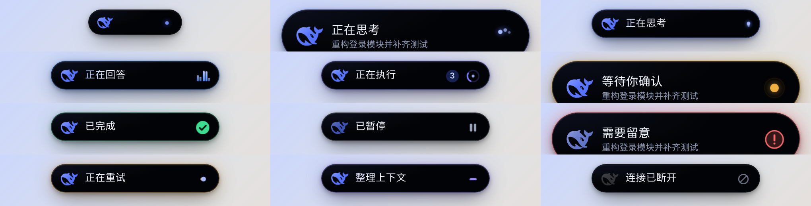
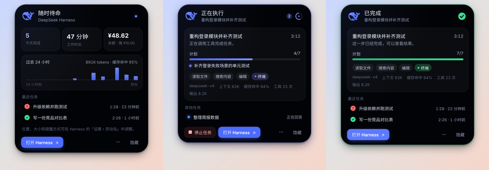
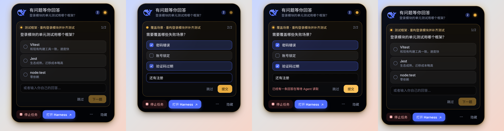
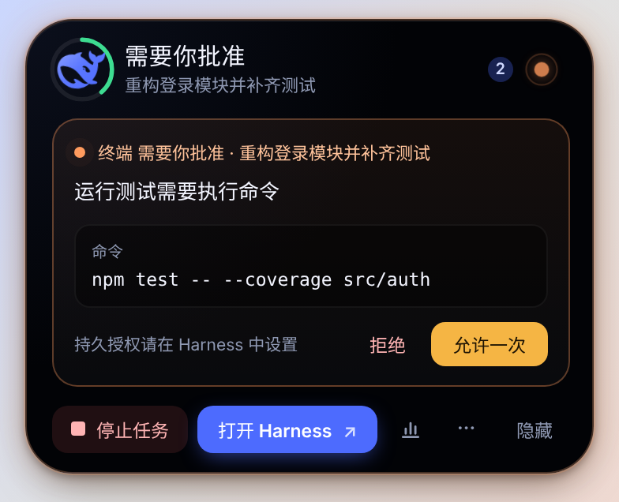
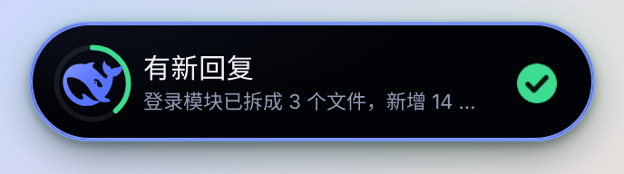
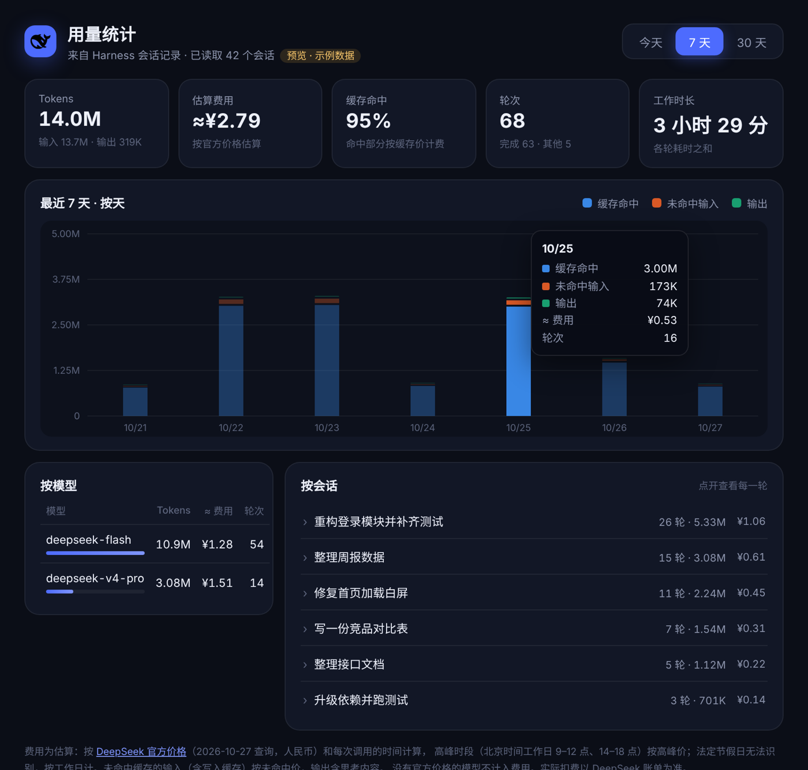
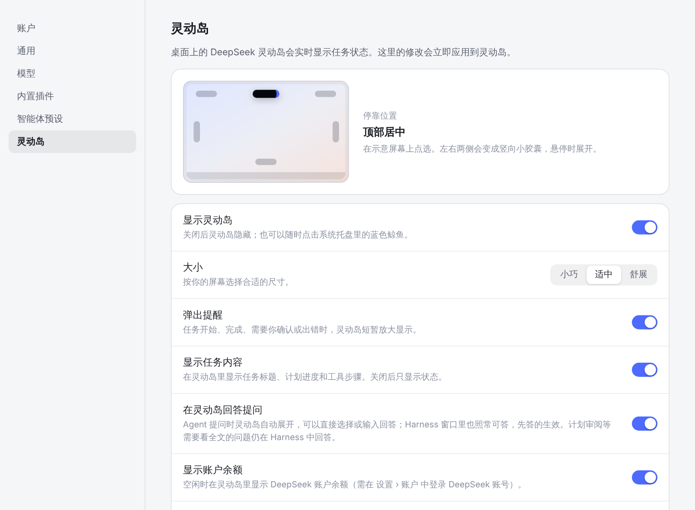

# DeepSeek Island · 桌面灵动岛

DeepSeek Harness 的桌面灵动岛插件：像 iPhone 灵动岛一样停在屏幕边缘，实时显示 Agent 在做什么——思考、回答、执行工具、等你确认；展开后是任务控制台，可以看计划进度、上下文占用和用量、停止任务，直接批准权限请求、回答 Agent 的提问，任务完成时预览回复；另有按时间、模型、会话、轮次统计的用量窗口，并按 DeepSeek 官方价格估算费用。

> 社区插件，非 DeepSeek 官方产品。DeepSeek 名称与鲸鱼标志归其所有者。



| 任务控制台 | 在灵动岛回答提问 |
| --- | --- |
|  |  |

| 批准权限请求 | 有新回复 |
| --- | --- |
|  |  |





[动画录屏（mp4）](docs/motion.mp4)

## 安装

需要 **DeepSeek Harness 桌面版 0.2.1-rc.3**（Windows）。

- **在 Harness 里安装**：侧栏「插件」→「添加插件」，输入 `dsh-island`，安装后启用。
- **命令行**：先从托盘退出 Harness，再运行 `dsh plugin --profile desktop add dsh-island`。
- **从源码**：克隆本仓库，双击 **安装到 Harness.cmd**。

装好后，位置、大小等选项在 Harness 的「设置 › 灵动岛」中调整。

## 形态

| 形态 | 尺寸（适中） | 何时出现 |
| --- | --- | --- |
| 待机 | 118 × 32 | 没有任务：只有鲸鱼和一颗呼吸的蓝点 |
| 紧凑 | 212 × 36 | 任务进行中：鲸鱼 · 状态文字 · 动态指示器，多任务时显示数量 |
| 弹出 | 312 × 66 | 新任务开始、等待确认、完成、异常时自动弹出几秒，显示任务标题；完成时显示回复开头 |
| 展开 | 344 × 自适应 | 鼠标停留约 0.7 秒或单击：任务控制台 |
| 竖向 | 32 × 78 / 36 × 104 | 停靠在左侧或右侧居中时变为竖条，悬停或提醒时横向舒展 |

尺寸、圆角、鲸鱼和指示器的位置都随形态一起用带轻微回弹的弹簧曲线过渡；状态切换时文字和图标做模糊交叉淡入。

任务进行中，鲸鱼外圈是**上下文占用环**：按当前上下文占模型窗口的比例描边，70% 以下绿色，70% 起黄色，90% 起红色并轻轻呼吸，提示快要整理上下文了。

## 使用

- 鼠标在灵动岛上停留片刻即展开任务控制台，移开后自动收起；悬停展开后再单击可固定，不随鼠标离开收起。可在设置中关闭悬停展开。
- 单击胶囊展开或收起，按 Esc 或点击灵动岛以外的任何地方收起；单击展开的面板在鼠标离开 6 秒后也会自动收起。提问卡里没提交的草稿会保留，重新展开可以接着答。
- “打开 Harness”回到主窗口；面板底部的柱状图按钮或托盘菜单「用量统计」打开用量窗口。
- “隐藏”只隐藏灵动岛，点系统托盘的蓝色鲸鱼可重新显示；右键托盘可选显示器或退出。
- 透明区域不拦截鼠标；窗口置顶但出现时不抢输入焦点。

## 任务控制台（展开面板）

| 什么时候 | 显示什么 |
| --- | --- |
| 有任务进行中 | 任务标题与计时；Agent 计划的进度条（如 4/7）和当前步骤；最近几步工具（读取文件、编辑、终端…）；模型、上下文占用（如 412K / 1.0M (39%)）、缓存命中率、工具次数、输出 tokens；其他同时进行的任务；**停止任务**按钮 |
| 刚结束 | **有新回复**：Agent 最后一条回复的开头（点击回到 Harness 看全文）；结果、最终计划进度、本次用量 |
| 空闲 | 今天完成的任务数、工作时长、DeepSeek 账户余额（未登录账号时显示今日 tokens）；过去 24 小时每小时的 token 柱状图、缓存命中率和今日估算费用；最近几个任务（结果、时长、多久以前） |

**停止任务**要点两次（第一次变红确认），效果与 Harness 里的停止按钮相同，只对顶层任务生效；子智能体不会单独列为任务，除非它在等你确认或出错。用量数据来自 Harness 自己的会话记录（`ctx.sessionQuery`）：启用后在后台补算最近 30 天的会话，之后跟随实时事件更新，汇总保存在 `%USERPROFILE%\.dsh\dsh-island\usage.json`，只含会话标题、每轮的模型、时间、结果、调用与工具次数、token 数和估算费用，保留 35 天，不含对话内容。

账户余额通过 Harness 自己的账户服务读取（与「设置 › 账户」相同），只在用 DeepSeek 账号登录时可用；灵动岛看不到任何令牌或 API Key。打开面板时最多每分钟刷新一次，另外每 10 分钟刷新一次。

## 在灵动岛给 Agent 发消息

展开面板顶部是对话卡：上面是这个任务最近一次的回复（最多 4000 字，可滚动、可复制），下面是输入框，**不用打开 Harness 就能接着聊**。Enter 发送，Shift+Enter 换行，中文输入法选字时按 Enter 不会误发。

- 发给谁：正在显示的任务；空闲时发给最近一个任务。子智能体不会成为对象。
- 空闲时点 **发送** 开始新一轮；任务进行中点 **排队**（这一轮结束后发送），或点 **插话**（插入正在进行的这一轮，Agent 下一步就会看到）。
- 走的是 Harness 自己输入框用的同一个接口（会话控制器的 `prompt`），消息会出现在 Harness 的对话记录里；已关闭的任务会被自动恢复。没有选好模型等原因发送失败时，输入框里的内容保留，可以直接重试。
- 暂不支持新建对话和发送图片、文件，这些仍在 Harness 中操作。可在设置中关闭「在灵动岛给 Agent 发消息」。

## 在灵动岛回答提问

Agent 用 `ask_user_question` 提问时，灵动岛自动展开提问卡：单选、多选、自己输入、跳过都可以，多个问题逐个回答后一次提交。Harness 窗口里的提问卡照常可用，**哪边先答用哪边**；灵动岛先答时，Harness 里的那张卡会随之关闭。没有打开 Harness 窗口时，灵动岛就是回答入口。问题超时后转为“继续”状态，仍可在灵动岛回答，回答作为一条回复送回 Agent，与 Harness 的处理方式相同。

计划审阅（plan mode）和带长说明的问题需要看全文，仍在 Harness 中回答。可在设置中关闭「在灵动岛回答提问」。

## 在灵动岛批准权限请求

Agent 要执行需要授权的操作（运行命令、修改文件、访问网址等）时，灵动岛变为“需要你批准”并自动展开审批卡，显示是哪个工具、为什么、具体要做什么（命令全文、文件路径或网址）。可以 **允许一次** 或 **拒绝**；按钮在卡片出现后约 0.6 秒才可点，避免误触。Harness 窗口里的审批卡照常可用，**哪边先批用哪边**，灵动岛先批时 Harness 里的卡随之撤下；没有打开 Harness 窗口时灵动岛就是审批入口。多个请求依次处理。

“始终允许”等持久授权不在灵动岛提供，仍在 Harness 中设置；子智能体的请求也在 Harness 中处理。可在设置中关闭「在灵动岛批准权限请求」。

## 用量统计

从面板底部的柱状图按钮或托盘菜单打开，范围可选 **今天**（按小时）、**7 天**、**30 天**（按天）：

- 概览：总 tokens、估算费用、缓存命中率、轮次（完成/其他）、工作时长。
- 堆叠柱状图：缓存命中 / 未命中输入 / 输出，悬停查看每段的数量、费用和轮次。
- 按模型：tokens、估算费用、轮次。
- 按会话：每个会话的轮次、tokens、费用，点开看每一轮的结束时间、模型、调用与工具次数、各类 tokens 和费用。

费用按 [DeepSeek 官方价格](https://api-docs.deepseek.com/zh-cn/quick_start/pricing)（2026-10-27 查询，人民币/百万 tokens）逐次调用估算：

| 模型 | 时段 | 缓存命中输入 | 未命中输入 | 输出 |
| --- | --- | --- | --- | --- |
| deepseek-flash | 空闲 / 高峰 | 0.02 / 0.04 | 1 / 2 | 4 / 8 |
| deepseek-v4-pro | 空闲 / 高峰 | 0.15 / 0.30 | 4.5 / 9 | 13.5 / 27 |

高峰时段为北京时间工作日 9:00–12:00、14:00–18:00（法定节假日无法识别，按工作日计）。写入缓存的输入按未命中价，输出含思考内容；已下线的 `deepseek-v4-flash` 按 Flash 价计；没有官方价格的模型不计入费用。估算仅供参考，实际扣费以 DeepSeek 账单为准。

## 在 Harness 中设置

位置、大小等选项在 Harness 的 **设置 › 灵动岛** 中，修改后立即生效，无需重启：

| 选项 | 说明 |
| --- | --- |
| 停靠位置 | 在示意屏幕上点选：左上、顶部居中、右上、左侧居中、右侧居中、底部居中 |
| 显示灵动岛 | 关闭即隐藏；打开时会重新显示 |
| 大小 | 小巧、适中、舒展 |
| 弹出提醒 | 任务开始、完成、需要确认或出错时短暂放大 |
| 显示任务内容 | 关闭后不显示任务标题、计划内容、工具名、审批详情和回复预览，只显示状态 |
| 在灵动岛回答提问 | Agent 提问时自动展开提问卡，可直接回答 |
| 在灵动岛批准权限请求 | 需要授权时显示审批卡，可允许一次或拒绝 |
| 在灵动岛给 Agent 发消息 | 面板里显示输入框，接着当前或最近的任务对话 |
| 悬停展开面板 | 鼠标停留即展开，移开收起；关闭后需要单击 |
| 显示账户余额 | 空闲时显示 DeepSeek 账户余额 |
| 减少动态效果 | 关闭循环动画和弹性过渡（也跟随系统设置） |

这些选项保存在 Harness 的 desktop profile 配置中（插件条目 `dsh-island`）。显示器选择和“隐藏”状态仍由托盘菜单在本地保存。

## 状态与动效

| 状态 | 主色 | 动效 |
| --- | --- | --- |
| 随时待命 | 品牌蓝 | 鲸鱼缓慢漂浮，蓝点呼吸 |
| 正在思考 | 靛蓝 | 三颗光点彗尾追逐；文字流光；底边光带滑过；鲸鱼游动 |
| 正在回答 | 亮蓝 | 五条节奏各异的声波 |
| 正在执行 | 蓝紫 | 伸缩弧环旋转、内核跳动；显示工具名 |
| 等待你确认 | 琥珀 | 双层涟漪扩散，外圈光晕呼吸，鲸鱼轻轻探头；有提问时显示“有问题等你回答”并展开提问卡 |
| 已完成 | 绿 | 圆盘弹出、对勾描画，鲸鱼跃起并喷出水花，胶囊轻弹 |
| 已暂停 | 灰 | 双竖线依次落定 |
| 需要留意 | 柔红 | 圆标弹出，整个胶囊左右轻摇（像输错密码） |
| 正在重试 | 琥珀 | 两颗光点交换位置 |
| 整理上下文 | 紫 | 三层线条收拢再展开 |
| 连接已断开 | 灰 | 斜杠圆，鲸鱼褪色 |

竖向停靠时，中间细脊会有光点自上而下流过。支持系统“减少动态效果”和插件自己的动效开关（打开后所有动画立即停止）。完成、暂停约 6.5 秒后收回待机；错误提醒显示 15 秒。多任务时优先显示待确认和异常，其次是进行中的任务。

## 从源码安装与卸载

适配并检查的版本：**DeepSeek Harness Desktop 0.2.1-rc.3 / Windows**。

双击项目里的 **安装到 Harness.cmd** 即可（会先询问是否关闭 Harness，装完自动重新打开；会在常见安装位置和正在运行的 Harness 中查找 `dsh.cmd`）。也可以先从托盘退出 Harness，然后运行：

```powershell
powershell -NoProfile -ExecutionPolicy Bypass -File scripts/install-desktop.ps1
```

重新打开 Harness 即显示。卸载：

```powershell
powershell -NoProfile -ExecutionPolicy Bypass -File scripts/install-desktop.ps1 -Action Remove
```

安装由官方 `dsh plugin --profile desktop add` 完成。本插件不修改悬浮球插件或宿主安装目录，不增加开机自启。设置保存在 `%USERPROFILE%\.dsh\dsh-island\settings.json`。退出 Harness 或停用插件后，窗口随宿主关闭。

运行环境复用当前机器已有的 `%USERPROFILE%\.dsh\dsh-orb\electron-runtime\electron.exe`。它不是独立安装包：在其他机器上需要已有 Electron，或使用环境变量 `DSH_ISLAND_ELECTRON` 指定其路径。安装归档不含 Electron，不会自动下载运行环境。可用 `DSH_HOME` 指定 Harness 数据根目录。

## 动画预览

```powershell
npm run preview
```

预览窗口每 4.5 秒循环一个状态，面板里是标明“示例数据”的演示内容；展开后可手动切换，位置和大小在托盘菜单里调。也可双击项目里的“打开动画预览.cmd”。它明确标注“预览模式”，不代表真实任务。预览设置与正式插件分开保存在项目 `.preview` 目录。

## 开发与验证

代码无需打包器和运行时 npm 依赖。`src/host.js` 使用 Cordis 生命周期及 `session/event`、`agent/assistant-stream`、`agent/status`、`agent/error`，通过父子进程 IPC 向隔离的 Electron 页面发送状态；`src/settings.js` 用 Harness 自带的 schemastery 声明 volatile 配置，`loader/volatile-update` 时把新设置转发给窗口；`web/client.js` 是 Harness 设置页的浏览器半侧（通过 `dsh.client` 声明加载）。传给灵动岛的只有状态、任务标题、Agent 计划条目、工具名、模型名、token 数、账户余额、等你回答的问题和选项，以及已完成一轮的最终回复（关闭「显示任务内容」后不传）；不会读取密钥，也不传递你的提问、思考正文、进行中的文本或工具参数。你在灵动岛输入的消息经 IPC 交给 Harness 的会话控制器，灵动岛本身不保存。没有新增 HTTP 监听端口。加载时接管正在运行任务的概括状态，之后使用实时事件细分；不重放历史对话。

```powershell
npm test
npm run test:host
npm run test:desktop
npm run pack:plugin
```

桌面交互检查使用 Playwright，先运行 `npm install` 安装开发依赖；也可设置 `DSH_TEST_DEPS` 为已有的 Playwright 所在 `node_modules`。`DSH_HOST_EXECUTABLE` / `DSH_HOST_PACKAGE` 可指定另一处 Harness 安装以检查版本兼容。更换宿主版本时应先重新验证契约，不应绕过兼容门禁。

真实模型任务、网络重试和确认流程的完整现场验收与合成事件测试不同；具体已验证范围见 `VALIDATION.md`。

## 致谢

面板中的余额、24 小时 token 柱状图、缓存命中率和在灵动岛回答提问参考了 [Agent HUD](https://github.com/jazzenchen/agent-hud-native-open)（Apache-2.0）的设计思路；本项目未使用其代码。
